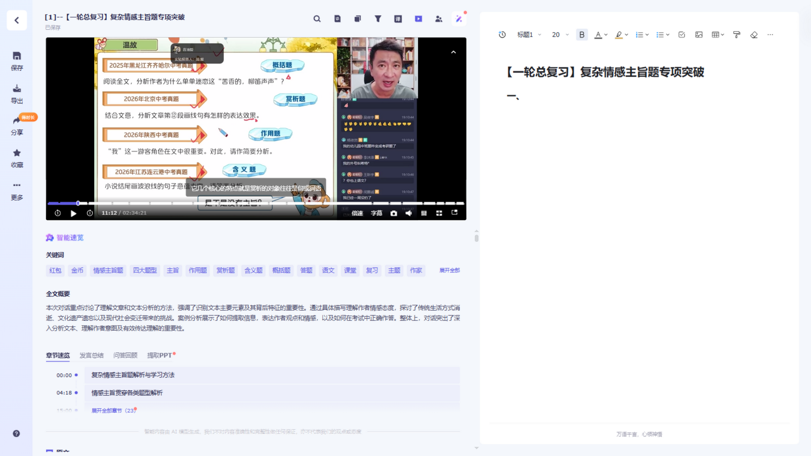

# 听悟净化 · Tingwu Purify

> 通义听悟（tingwu.aliyun.com）转写页布局增强：**隐藏 AI 生成内容、视频按真实 16:9 放大约 2~3 倍、笔记栏弹性适配**，一键切换剧场模式。看网课、看长视频的观感直接起飞。

## 改造前 / 改造后（同为 1920×1080）

| 改造前 | 改造后 |
|---|---|
|  |  |

**改造前**：视频只有 512×288，下方堆着 18 个关键词标签、全文概要、章节速览等 AI 内容，转写正文被挤到两屏之外。
**改造后**：AI 噪音全部消失，视频 1190×670 严格 16:9 满格显示，转写紧跟视频，笔记栏自动吃掉剩余空间。

## 功能

- 🧹 **隐藏 AI 生成内容**：关键词标签云、全文概要、章节速览/发言总结/问答回顾/提取PPT、AI 免责声明——全部消失，只留纯转写
- 📺 **视频大幅放大**：视频容器锁定严格 16:9（`aspect-ratio`），宽度优先撑满中栏、最高可达视口 62%；画面、控制栏、字幕由播放器自适应重排，无黑边、无变形、无漂移
- 🔀 **布局弹性跟随**：中栏宽度跟随视频，笔记栏弹性占满剩余空间——大屏上笔记自动变宽
- 🎬 **剧场模式**：按 `Alt + V` 隐藏笔记栏、视频升至视口 80%，再按返回
- 🛡️ **零侵入**：不请求任何网络资源、不上传任何数据；转写、笔记、批量导出 Word 等原生功能全部保留

## 安装

### 方式一：油猴脚本（推荐）

1. 浏览器安装 [Tampermonkey](https://www.tampermonkey.net/) 扩展
2. **Chrome 138+ 需额外一步**：打开 `chrome://extensions`，开启右上角「开发者模式」
3. 点击安装链接（任选其一，把 `YOUR-USERNAME` 替换为仓库所有者的 GitHub 用户名）：
   - GitHub 直链：`https://raw.githubusercontent.com/YOUR-USERNAME/tingwu-purify/main/tingwu-purify.user.js`
   - jsDelivr CDN（国内更快）：`https://cdn.jsdelivr.net/gh/YOUR-USERNAME/tingwu-purify@main/tingwu-purify.user.js`
4. 打开通义听悟任意转写记录页，自动生效

### 方式二：书签版（免插件）

1. 下载本仓库的 `bookmark.html`，双击在浏览器打开
2. 把页面中的蓝色按钮拖到书签栏（`Ctrl+Shift+B` 显示书签栏）
3. 打开转写记录页后点一下书签即生效（每次刷新页面后需再点一次）

## 使用

| 操作 | 效果 |
|---|---|
| 打开转写页 | 自动生效（油猴版）/ 点书签生效（书签版） |
| `Alt + V` | 切换剧场模式（视频最大化 ↔ 恢复笔记栏） |
| 修改 `VIDEO_VH`（脚本开头） | 调整视频高度上限（默认 62，即视口 62%） |
| 修改 `THEATER_VH` | 调整剧场模式高度上限（默认 80） |

## 工作原理

通义听悟的 goldplay 播放器会把首次测量的尺寸写死成内联样式，导致视频高度被锁在视口 40%；其内部图层（画面/控制栏）由 JS 按像素绝对定位，直接改外壳必然漂移。

本脚本只做一件事：把播放器**外层容器**用 CSS 不变式（`aspect-ratio: 16/9` + `width: min(100%, calc(62vh * 16/9))`）定为严格 16:9。播放器自带的 ResizeObserver 会自动按新容器重新初始化全部内部图层，坐标天然自洽。AI 内容区块则通过文本特征（关键词/全文概要/章节速览）识别后隐藏，页面重渲染后由 MutationObserver 守护重新应用。

## 已知限制

- 通义听悟前端更新后可能失效（依赖其 DOM 结构），欢迎提 Issue，通常很快可修
- 仅在 `tingwu.aliyun.com/doc/*`（转写详情页）生效

## 免责声明

本项目为个人学习用途的非官方增强脚本，与阿里云/通义听悟无任何关联。请自行确保使用符合相关服务条款。

## License

[MIT](LICENSE)
